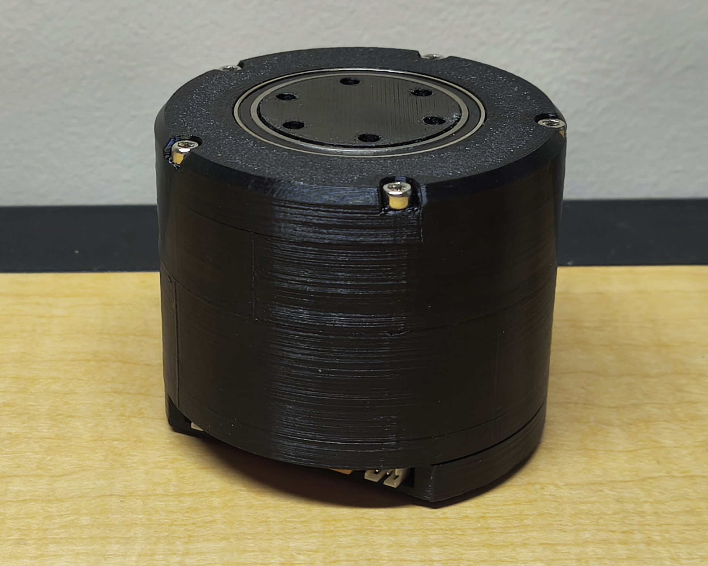

# **Integrated FOC BLDC Actuator**
A portable, self-contained closed loop Field Oriented Controller (FOC) for Brushless DC (BLDC) motors built on the ESP32-S3 via a custom designed PCB.
This project focuses on the development of a robust FOC controller for BLDC motors to be integrated into future robotic systems, such as robotic arms or other kind of robots. The controller combines the advantages of different motor technologies, offering:
- The **speed** of a BLDC motor
- The **precision** of a stepper motor
- The **torque** provided by cycloidal gear reductions

---

<p align="center">
  
  
</p>

<p align="center">
  <em>Both CAD and 3D printed preliminary models</em>
</p>

---

## **Features and Goals**
- **High Performance**: Closed-loop sinusoidal PWM (SPWM) field-oriented control for precise speed, position, and torque management.
- **Integrated Protection**: Reverse polarity protection (RPP), fault detection for overvoltage, overcurrent, DRV8302 hardware faults (NFAULT/NOCTW), magnetic encoder field anomalies and IMU fault.
- **Advanced Sensors**: Magnetic encoder (MT6701) for precise motor shaft angle, BMI270 IMU for 3D acceleration and gyroscope tracking, and NTC thermistor for temperature monitoring.
- **Modularity**: Designed for portability and adaptability across multiple robotic platforms. Independent sensor and driver classes with clean interfaces.
- **Multi-Task Architecture**: FreeRTOS task scheduler on dual cores with semaphore and mutex protected shared data and a hardware timer ISR for all the control loops.
- **CAN Bus Communication**: MCP2551 transceiver for daisy chain communication in robotic systems.
- **Power Bus Connection**: Dual XT30 connectors provide easy connection between different motors in the same bus.

---

## **Hardware**
### **Core Components**
- **Microcontroller**: ESP32-S3 WROOM (dual core, 240 MHz)
- **Motor Driver**: DRV8302 3 phase gate driver with integrated current sense amplifiers
- **Sensors**:
  - **MT6701 Magnetic Encoder**: SSI interface, 14 bit resolution (16384 counts/rev), diametrically magnetized rotor for absolute shaft angle
  - **BMI270 IMU**: 3 axis accelerometer and gyroscope via 3 wire SPI
  - **NTC Thermistor**: B=3380 K, real time board temperature monitoring with Steinhart Hart equation
  - **PVDD Voltage Divider**: Resistor divider on ADC2 for bus voltage monitoring
- **CAN Transceiver**: MCP2551 for multi motor communication at up to 1 Mbps

### **Protection Features**
- Reverse polarity protection with integrated MOSFET and parallel zener diode
- TVS protection against exterior ESD discharges
- Overvoltage detection on PVDD (configurable threshold) with immediate driver shutdown
- DRV8302 hardware fault latch (NFAULT + NOCTW) with software latch counter and hysteresis
- MT6701 magnetic field anomaly detection
- IMU wrong data detection
- Watchdog timer (WDT) subscription on all FreeRTOS tasks to catch runaway loops

---

<p align="center">
  
  
</p>
<p align="center">
  
  
</p>
<p align="center">
  <em>Soldered PCB V1</em>
</p>

    
---

## **Mechanical Design**
- **Cycloidal Gearbox**: For torque amplification and precision gain, 15:1 gear reduction. Features dual disc configuration to supress motor vibrations.
- **Modified motor coupling**: The motor and gearbox coupler presents a D slot to transfer the rotation power without the need for small screws as in previous versions.
- **Integrated bearings**: Metallic bearings offer a smooth movement of the gearbox with outer steel pins.
- **Integrated Motor**: 5010 750KV motor integrated into the enclosure.
- **Integrated PCB**: The PCB support has been designed to be as compact as possible, reading the magnet from the motor axis and preventing external cables outside the casing.
- **Custom PCB (V1)**: Compact integration of ESP32-S3, DRV8302, MT6701, BMI270, MCP2551, and NTC. Schematic available in `ESP32_Motor_Controller_V1.pdf`.
- **Custom PCB (V2)**: Several improvements implemented and corrected errors from V1:
  - Voltage upgrade: Input raised to 36 V (MOSFET max 40 V); RPP, TVS diode, phase voltage dividers, and MOSFET selection updated accordingly (targeting ≥50 V rating).
  - Dual configuration for higher power motors and lower power ones (16V vs 36V).
  - Passives:
    - Large-value caps (22 µF, 1 µF) moved to 0805+ for voltage headroom
    - All MOSFET line power caps in 0805
    - GVDD/AVDD/DVDD decoupling can stay 0603 (16 V rated)
    - BOM consolidated to reuse values/footprints.
  - Layout:
    - Power and sensor zones separated
    - Routing improved with stitching vias
    - External pull-up resistors added on I2C lines
  - Gate series resistance tuned.
  - Schematic available in `ESP32_Motor_Controller_V2.pdf`.

---
<p align="center">
  
  
</p>

<p align="center">
  <em>Mechanical CAD Design</em>
</p>

---

## **Firmware Architecture**

### **State Machine**
The main task runs a three-state machine:

```
SYSTEM_INIT → SYSTEM_CALIBRATION → SYSTEM_RUNNING
```

- **INIT**: Initializes MT6701 and DRV8302. Retries on failure.
- **CALIBRATION**: Sets up MCPWM, performs current sense offset calibration (DC_CAL pulse, 500 samples averaged), and magnetic encoder field quality check (1000 samples).
- **RUNNING**: Monitors faults in the main loop; all control logic runs in ISR-driven FreeRTOS tasks.

### **Control Loop (Timer ISR at 20 kHz)**
A hardware timer (APB clock / 80 divider = 1 MHz, alarm at 50 µs) triggers task notifications at divided rates:

| Task | Rate | Core | Priority |
|---|---|---|---|
| `focLoop` | 20 kHz | 1 | 10 |
| `magLoop` | 5 kHz | 1 | 9 |
| `drvLoop` | 500 Hz | 0 | 8 |
| `telemetryLoop` | 100 Hz | 0 | 2 |

All shared data (`drv_pkg`, `mag_pkg`) is protected by FreeRTOS mutexes.

### **SPWM Generation**
`DRV::update_spwm()` runs three stages:

1. **Alignment (Open loop)**: Ramps duty cycle over 500 ms to lock rotor to a known electrical angle. Computes `elec_offset` from the MT6701 reading at alignment.
2. **Frequency Ramp**: Linearly ramps `electrical_freq` from 2 Hz to `target_electrical_freq` (20 Hz default) at 100 Hz/s.
3. **Closed Loop SPWM**: Uses MT6701 angle + `elec_offset` + pole pairs (7) to compute instantaneous electrical angle.

Motor parameters (5010 750KV, 14 poles, 270 mΩ phase resistance, 40 A max) are defined as `constexpr` in `DRV.h`.

### **Current Sensing**
- Two shunt channels (SO1, SO2) on ADC1 with DRV8302 internal amplifier (gain selectable via GAIN pin, default 40×, R_shunt = 10 mΩ)
- DC offset calibration via `DC_CAL` pin pulse at startup, sanity-checked against 12-bit midpoint (valid range 1000–3000)
- Third phase current reconstructed as `I_C = -(I_A + I_B)`

---

## **Software**
1. **Motor Calibration**: Automated at boot — current sense offset calibration and magnetic field quality verification.
2. **Real Time Telemetry**: UART serial output at 100 Hz: PVDD voltage, phase currents, raw ADC values, NFAULT/NOCTW states, NTC temperature, and encoder angle/status.
3. **Debug Mode**: `debug_mode_enabled` flag bypasses the state machine for rapid hardware-in-the-loop testing.
4. **Fault Override**: Per-subsystem override flags (`DRV::set_override`, `MT6701::set_override`) for bench testing without a valid magnetic field or full power stage.

Integration with ROS2 and a graphical PID tuning interface are planned for future iterations.

---


## **References**
- [SimpleFOC Library](https://github.com/simplefoc/simplefoc)
- [ODrive Pro Documentation](https://docs.odriverobotics.com/v/latest/hardware/pro-datasheet.html)
- DRV8302 Datasheet (`drv8302.pdf`)
- MT6701 SSI Encoder Datasheet
- ESP32-S3 WROOM Datasheet (`ESp32_S3_WROOM.pdf`)
